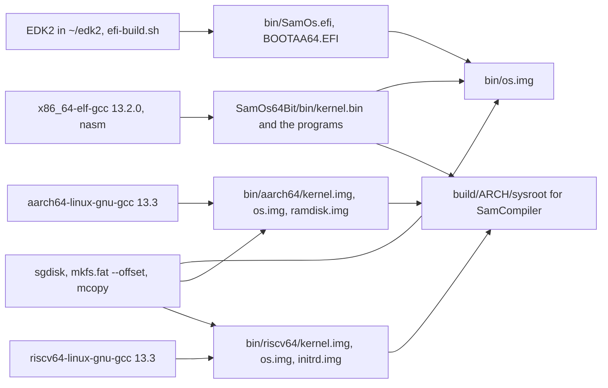
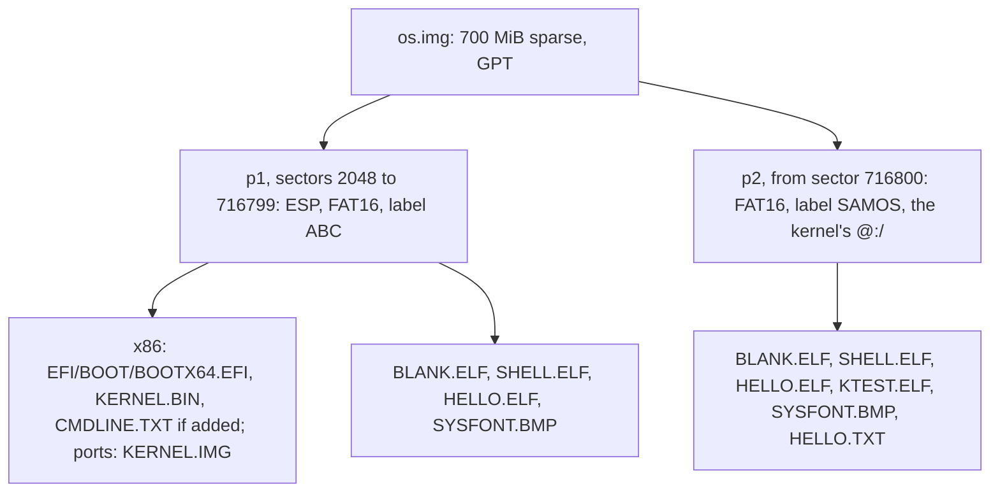
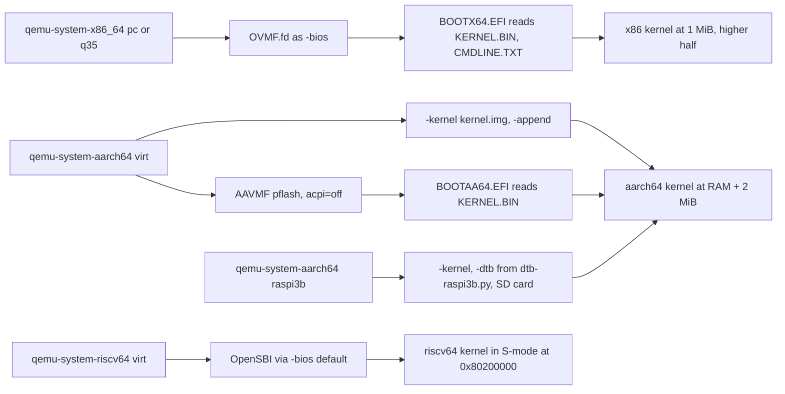
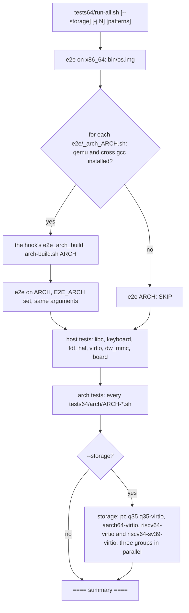
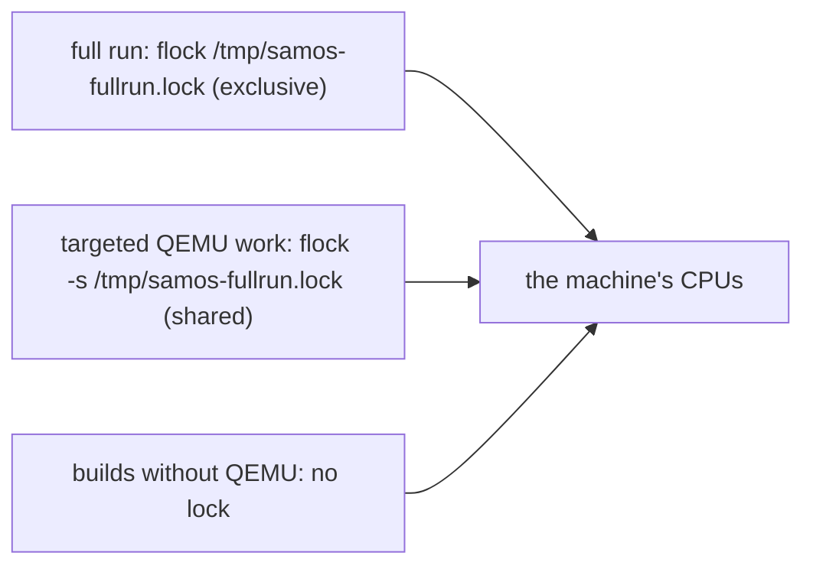
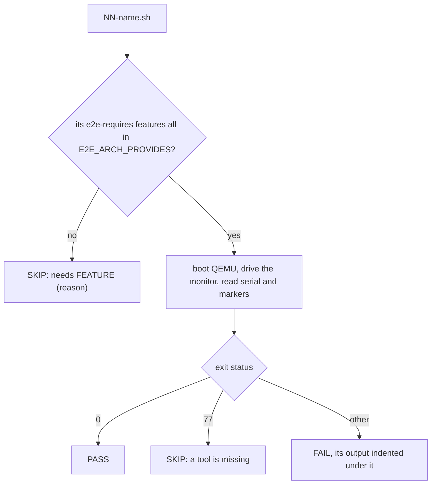
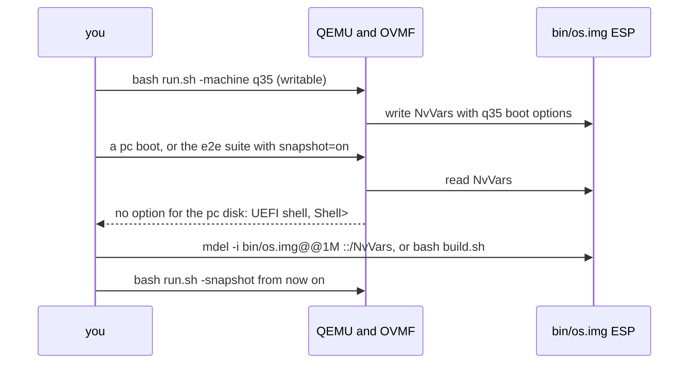

# SamOS guide: dependencies, building, running and testing on x86-64, ARM64 and RISC-V

This is the one place that says how to get every tool SamOS needs, how to
build it for its three architectures, how to boot it in QEMU on each
machine it supports, how to run its tests and read their results, and
what to do when something fails. It replaces the short "Build and run"
section that `README.md` used to carry.

It describes the tree with the PCI
and test parity work for the ports, the Raspberry Pi and VisionFive 2
ports and the SamCompiler userland in place. Everything marked
**verified** was run on a host like the one in section 2.1; anything
marked **untested** was not.

Not covered by the verified runs: a rebuild of the cross compiler or of
EDK2 from scratch, anything on real hardware, and macOS. Not described
here: networking.

## Contents

1. [The pipeline in one picture](#1-the-pipeline-in-one-picture)
2. [Host requirements](#2-host-requirements)
3. [Installing the dependencies](#3-installing-the-dependencies)
4. [Getting the source](#4-getting-the-source)
5. [Building](#5-building)
6. [Running in QEMU](#6-running-in-qemu)
7. [The shell once booted](#7-the-shell-once-booted)
8. [Testing](#8-testing)
9. [User programs with SamCompiler](#9-user-programs-with-samcompiler)
10. [Debugging](#10-debugging)
11. [Real hardware](#11-real-hardware)
12. [Troubleshooting](#12-troubleshooting)
13. [Where the rest of the documentation is](#13-where-the-rest-of-the-documentation-is)

## 1. The pipeline in one picture

*Diagram: from host tools to boot images.*



The x86-64 kernel boots through UEFI: the EDK2 loader `SamOs.efi`
(installed as `\EFI\BOOT\BOOTX64.EFI`) reads `KERNEL.BIN` and
`CMDLINE.TXT` from the ESP, exits boot services and jumps to the kernel.
The ARM64 and RISC-V kernels are Linux-style `Image` files that QEMU loads
with `-kernel` (ARM64 can also boot through AAVMF and the same loader
built for AArch64). On every architecture the boot disk has the same GPT
layout: partition 1, the ESP (FAT16, label `ABC`), and partition 2, the
`SAMOS` volume (FAT16) that the kernel mounts as `@:/`.

## 2. Host requirements

### 2.1 A tested host

| | |
|---|---|
| OS | Ubuntu 24.04.3 LTS in WSL2 on Windows 11 (WSL kernel `6.6.87.2-microsoft-standard-WSL2`) |
| CPU, RAM | 12 logical CPUs, 11 GiB RAM visible to WSL, 16 GiB swap |
| Disk | ext4 inside the WSL virtual disk (the repository lives in `~`, not under `/mnt/c`) |

Native Ubuntu 24.04 needs nothing different. Debian 12 should work
(bootstrap.sh says so) but is **untested** here; older distributions may
need other `gcc-NN` packages and EDK2 toolchain tags.

**macOS: untested.** The scripts assume GNU tools: `stat -c`, `sed -i`
without a suffix, `truncate`, `flock` (util-linux, used by
`efi-build.sh`), `timeout`, `mkfs.fat --offset`, `sgdisk`, `sfdisk`. With
Homebrew's `coreutils`, `gnu-sed`, `util-linux`, `gptfdisk`, `dosfstools`,
`mtools`, `nasm`, `qemu` and an `x86_64-elf-gcc` it may be made to work,
but nobody has done it; use a Linux VM instead.

### 2.2 WSL notes

- Keep every tree on the Linux file system (`~/SamOS`). Under `/mnt/c`
  builds are many times slower, executable bits are lost, and two files
  that differ only in case cannot coexist.
- The scripts are not executable in git (mode 100644): run them as
  `bash build.sh`, `bash run.sh`, not `./run.sh`.
- From Windows, a script in WSL runs as
  `wsl.exe -d Ubuntu-24.04 -- bash /path/to/script.sh` (from Git Bash
  add `MSYS_NO_PATHCONV=1` in front so the path is not rewritten).
- Under extreme host load WSL itself can stop answering
  (`Wsl/Service/0x8007274c`, seen at a load average near 60). Wait and
  retry; nothing is wrong with SamOS.

### 2.3 Disk space

Measured on the host above:

| What | Size |
|---|---|
| `~/opt/cross` (the x86_64-elf toolchain) | 938 MiB |
| `~/src/cross-build` (its sources and build trees; deletable after `make install`) | 3.6 GiB |
| `~/edk2` with BaseTools built and a few loader builds | 2.5 GiB |
| a SamOS worktree after building all three architectures | about 32 MiB on disk |
| each `os.img` | 700 MiB apparent, about 1.3 MiB on disk (sparse) |

The disk images are sparse: copy them with `cp --sparse=always`, never
through a tool that fills holes. The e2e tests copy images into
`$TMPDIR` (default `/tmp`), and the storage test makes a 160 GiB sparse
image there, so keep a few GiB free in `/tmp` and use a file system with
sparse files (not a FAT USB stick).

### 2.4 Memory and CPU

Every QEMU gets 512 MiB unless a test asks for more (e2e/209-usb-dma32
runs a 6 GiB guest, sparse in practice). `run-all.sh -j N`
runs N QEMUs at once and the three architectures one after another, so
`-j 3` needs roughly 2 GiB plus the host. Under QEMU's TCG every guest CPU
is a host thread (tests with `E2E_SMP` above 1 use `-accel
tcg,thread=multi`).

**Load matters more than speed.** The tests check what the kernel does,
not how fast, but they still wait with timeouts, and a host load average
above about 20 on 12 CPUs has produced false failures: missed sentinels,
"a CPU did not answer a call" panics in SMP tests, merged timer ticks, an ARM64 boot that printed nothing within its
timeout. Check `uptime` before a full run, prefer `-j 2` or
`-j 3`, and rerun a failing test alone before believing it (section
8.10).

## 3. Installing the dependencies

### 3.1 The quick way: bootstrap.sh

```bash
cd ~/SamOS
bash bootstrap.sh
```

It has three layers, each a no-op when its result is already present, so
it can be rerun at any time (**verified**: on an installed host all
three layers report OK without changing anything):

1. apt packages (with `sudo apt install`, only the missing ones);
2. the `x86_64-elf` cross compiler, built from source into
   `$HOME/opt/cross` (20 to 40 minutes);
3. EDK2 cloned into `$HOME/edk2`, its BaseTools built, and this tree
   symlinked as `MdeModulePkg/Application/SamOs`.

Variables: `PREFIX` (default `$HOME/opt/cross`), `TARGET`
(`x86_64-elf`), `EDK2_ROOT` (`$HOME/edk2`), `BINUTILS_VER` (`2.42`),
`GCC_VER` (`13.2.0`).

Its apt list lacks four packages that the build or the tests use; install
them as well (section 3.2): `gdisk` (`sgdisk`, needed by `build.sh`),
`qemu-efi-aarch64` (AAVMF, for the ARM64 UEFI boots and `aarch64-uefi.sh`),
`fdisk` (`sfdisk`, for the storage test and the Pi image; present on
every Ubuntu install anyway) and `gdb-multiarch` (debugging). Its closing
"Next steps" text still says `tests64/e2e/run-all.sh` and "122 e2e
tests"; the entry point is `tests64/run-all.sh` (section 8) and the suite
has about 190 tests.

### 3.2 apt packages, one by one

One line for everything (Ubuntu 24.04):

```bash
sudo apt update
sudo apt install -y build-essential nasm make git wget python3 \
    qemu-system-x86 qemu-system-arm qemu-system-misc qemu-utils \
    ovmf qemu-efi-aarch64 opensbi \
    mtools dosfstools gdisk fdisk parted \
    gcc-aarch64-linux-gnu binutils-aarch64-linux-gnu \
    gcc-riscv64-linux-gnu binutils-riscv64-linux-gnu \
    bison flex libgmp3-dev libmpc-dev libmpfr-dev texinfo libisl-dev \
    uuid-dev acpica-tools python3-distutils-extra \
    gdb-multiarch device-tree-compiler
```

What each one is for, and the version tested (`dpkg-query -W`):

| Package | Version | Used for |
|---|---|---|
| `build-essential`, `make` | 12.10ubuntu1, 4.3 | host `gcc` 13.3.0 (host tests, SamCompiler, building the cross compiler), GNU make |
| `nasm` | 2.16.01 | the x86 kernel's and user stubs' `.asm` files (`nasm -f elf64`); SamCompiler's x86 backends |
| `qemu-system-x86` | 8.2.2+ds-0ubuntu1.18 | `qemu-system-x86_64` (machines `pc` and `q35`) |
| `qemu-system-arm` | same | `qemu-system-aarch64` (`virt`, `raspi3b`) |
| `qemu-system-misc` | same | `qemu-system-riscv64` (`virt`, `sifive_u`) |
| `qemu-system-data` | same (pulled in) | the OpenSBI `fw_dynamic` firmware QEMU loads for `-bios default` on riscv64 (`/usr/share/qemu/opensbi-riscv64-generic-fw_dynamic.bin`) |
| `ovmf` | 2024.02-2ubuntu0.10 | x86 UEFI firmware, `/usr/share/ovmf/OVMF.fd` (`-bios`) |
| `qemu-efi-aarch64` | 2024.02-2ubuntu0.10 | AAVMF, `/usr/share/AAVMF/AAVMF_CODE.fd` and `AAVMF_VARS.fd` (pflash) |
| `opensbi` | 1.7-1~24.04.1 | installed by bootstrap.sh; no script uses it (QEMU's own copy above is what boots) |
| `mtools` | 4.0.43 | `mcopy`, `mmd`, `mtype`, `mdir`, `mdel` on image files (`img@@offset`) |
| `dosfstools` | 4.2 | `mkfs.fat` (with `--offset`), `fsck.fat` (storage test) |
| `gdisk` | 1.0.10 | `sgdisk`: the GPT of every `os.img` |
| `fdisk` (util-linux 2.39.3) | 2.39.3 | `sfdisk`: storage test (MBR FAT12 volume), the Pi SD image; also `flock` and `truncate` come from util-linux and coreutils |
| `parted` | 3.6 | installed by bootstrap.sh; no current script uses it |
| `gcc-aarch64-linux-gnu`, `binutils-aarch64-linux-gnu` | gcc 13.3.0, binutils 2.42 | the ARM64 port, used freestanding; EDK2's AArch64 loader build (`GCC_AARCH64_PREFIX`) |
| `gcc-riscv64-linux-gnu`, `binutils-riscv64-linux-gnu` | gcc 13.3.0, binutils 2.42 | the RISC-V port, used freestanding |
| `bison`, `flex`, `libgmp3-dev`, `libmpc-dev`, `libmpfr-dev`, `texinfo`, `libisl-dev` | 3.8.2, 2.6.4, 6.3.0, 1.3.1, 4.2.1, 7.1, 0.26 | building binutils and gcc for `x86_64-elf` |
| `uuid-dev`, `acpica-tools`, `python3-distutils-extra` | 2.39.3, 20230628, 3.0 | EDK2 BaseTools and its build |
| `python3` | 3.12.3 | EDK2's build, and the test helpers (`screen_text.py`, `make_bad_elf.py`, `storage/pattern.py`, `arch/dtb-*.py`); standard library only |
| `gdb-multiarch` | 15.1 | the GDB stub on all three architectures (section 10.3) |
| `device-tree-compiler` | 1.7.0 | optional: `dtc -I dtb -O dts` to read a device tree. Nothing in the build needs it; the tests write their device trees with `tests64/arch/dtb-*.py` and QEMU's `dumpdtb` |

Not needed: `xorriso`, `grub-*` (no ISO is made), `qemu-img` (all images
are raw), `iasl` beyond what `acpica-tools` brings for EDK2.

### 3.3 The x86_64-elf cross compiler, by hand

`bootstrap.sh` layer 2 does exactly this; the steps are here so that a
failure can be retried one at a time.

```bash
export PREFIX="$HOME/opt/cross" TARGET=x86_64-elf
export PATH="$PREFIX/bin:$PATH"
mkdir -p ~/src/cross-build "$PREFIX" && cd ~/src/cross-build

# binutils 2.42
wget https://ftp.gnu.org/gnu/binutils/binutils-2.42.tar.gz
tar -xf binutils-2.42.tar.gz
mkdir binutils-build && cd binutils-build
../binutils-2.42/configure --target=$TARGET --prefix="$PREFIX" \
    --with-sysroot --disable-nls --disable-werror
make -j"$(nproc)" && make install
cd ..

# gcc 13.2.0, C only, no headers (freestanding), with libgcc
wget https://ftp.gnu.org/gnu/gcc/gcc-13.2.0/gcc-13.2.0.tar.gz
tar -xf gcc-13.2.0.tar.gz
mkdir gcc-build && cd gcc-build
../gcc-13.2.0/configure --target=$TARGET --prefix="$PREFIX" \
    --disable-nls --enable-languages=c --without-headers
make -j"$(nproc)" all-gcc
make -j"$(nproc)" all-target-libgcc
make install-gcc install-target-libgcc
```

Check (the expected output):

```
$ ~/opt/cross/bin/x86_64-elf-gcc --version | head -1
x86_64-elf-gcc (GCC) 13.2.0
$ ~/opt/cross/bin/x86_64-elf-ld --version | head -1
GNU ld (GNU Binutils) 2.42
```

The commands are the ones bootstrap.sh runs.

You do not have to put `~/opt/cross/bin` on your `PATH`: `build.sh` and
`SamOs64Bit/build.sh` add it themselves. Add it if you call `make` in
`SamOs64Bit/` directly.

### 3.4 The ARM64 and RISC-V compilers

No cross compiler is built for the ports: Ubuntu's `aarch64-linux-gnu-gcc`
and `riscv64-linux-gnu-gcc` (13.3.0) are used freestanding (`-ffreestanding
-nostdlib -fno-pic -fno-pie -fno-stack-protector`, the port's own linker
script, `-static -no-pie`, only `-lgcc`). With those flags the Linux
triplets produce the same code as a bare-metal `*-elf` toolchain would.
To use a bare-metal toolchain anyway, pass
its prefix: `make ARCH=aarch64 CROSS=aarch64-elf-` or
`CROSS=aarch64-elf- bash arch-build.sh aarch64`.

### 3.5 EDK2 (the UEFI loader)

The loader `SamOs.efi` is an EDK2 module (top-level `SamOs.c`, `.inf`,
`.uni`), built inside an EDK2 checkout through a symlink.

```bash
git clone --depth 1 --recurse-submodules https://github.com/tianocore/edk2.git ~/edk2
make -C ~/edk2/BaseTools -j"$(nproc)"
ln -s ~/SamOS ~/edk2/MdeModulePkg/Application/SamOs   # efi-build.sh re-points it each build
```

bootstrap.sh does the same. A recent EDK2 checkout works; a `--depth 1`
clone takes whatever is current. The EDK2 toolchain tag is `GCC`
(`EDK2_TOOLCHAIN`), which works with a recent EDK2 and Ubuntu's gcc 13.

`efi-build.sh X64|AARCH64 OUT.efi` builds it. It:

- points the symlink at the tree it runs from and adds one line for
  `SamOs.inf` to `MdeModulePkg.dsc` if missing;
- deletes that module's EDK2 build directory first, because every
  worktree shares `~/edk2` and EDK2 rebuilds by timestamp only (a
  worktree otherwise got another worktree's older loader);
- holds `~/.samos-edk2.lock` (flock) for all of that, so parallel builds
  from several worktrees wait for each other;
- builds AARCH64 with `GCC_AARCH64_PREFIX=aarch64-linux-gnu-`.

**Verified:** `bash efi-build.sh AARCH64 SamOs64Bit/bin/aarch64/BOOTAA64.EFI`
(13 s, 28672 bytes) and the X64 build inside `build.sh` (24576 bytes).

No EDK2 at all? `build.sh` reuses an existing `bin/SamOs.efi`, or takes
one from anywhere with `SAMOS_EFI=/path/to/SamOs.efi bash build.sh`.

### 3.6 QEMU and firmware

QEMU 8.2.2 from Ubuntu is what everything was tested with. The firmware
each machine uses:

| Machine | Firmware | From |
|---|---|---|
| x86_64 `pc`, `q35` | `/usr/share/ovmf/OVMF.fd` as `-bios` | `ovmf` |
| aarch64 `virt` with `-kernel` | none (QEMU's own boot stub) | |
| aarch64 `virt` under UEFI | `/usr/share/AAVMF/AAVMF_CODE.fd` (read-only pflash) and a copy of `AAVMF_VARS.fd` (writable pflash) | `qemu-efi-aarch64` |
| aarch64 `raspi3b` (Raspberry Pi) | none: `-kernel` plus a device tree from `tests64/arch/dtb-raspi3b.py` | |
| riscv64 `virt`, `sifive_u` | OpenSBI `fw_dynamic` via `-bios default` | `qemu-system-data` |

### 3.7 SamCompiler (optional)

Only needed for the SamCompiler tests (e2e/208, `arch/*-samcc.sh`) and
for building the user programs with it (section 9). It is a separate
repository, built with the host gcc:

```bash
git clone <SamCompiler repository> ~/SamCompiler-src    # see section 4.1 for where it lives
cd ~/SamCompiler-src
git switch develop               # the branch with the samos targets; see below
bash build.sh                    # make clean, then make -j all: ./main
```

**Verified:** a fresh clone of SamCompiler built `main` with
`bash build.sh` in 22 s.

SamCompiler needs its samos targets
(`-target=samos-x86_64|samos-aarch64|samos-riscv64`, on its `develop`
branch), which also compile the whole user stdlib and every program
(`USERCC=samcc`, section 9.3). A SamCompiler without them answers
`Unknown target samos-x86_64`, and the SamOS tests that need it skip
(section 8.9).

It needs at run time: `nasm` (x86 targets), `aarch64-linux-gnu-as`/`-gcc`
and `riscv64-linux-gnu-as`/`-gcc` (ARM64 and RISC-V targets, `gcc` only
drives `ld`), the host `gcc` (x86-64 link) and SamOS's sysroot (section
9.1). `SAMCC` tells SamOS where the binary is (section 9.2).

### 3.8 Checking the installation

```bash
for t in nasm sgdisk mkfs.fat mcopy sfdisk python3 flock \
         qemu-system-x86_64 qemu-system-aarch64 qemu-system-riscv64 \
         aarch64-linux-gnu-gcc riscv64-linux-gnu-gcc gdb-multiarch; do
    printf '%-24s %s\n' "$t" "$(command -v $t || echo MISSING)"
done
~/opt/cross/bin/x86_64-elf-gcc --version | head -1
ls /usr/share/ovmf/OVMF.fd /usr/share/AAVMF/AAVMF_CODE.fd /usr/share/AAVMF/AAVMF_VARS.fd \
   /usr/share/qemu/opensbi-riscv64-generic-fw_dynamic.bin
ls ~/edk2/BaseTools/Source/C/bin/GenFw
bash bootstrap.sh            # every layer should say OK
```

On a complete install nothing is missing.

## 4. Getting the source

### 4.1 Where the code is

The current tree is the branch `develop` of the SamOS repository
(`https://github.com/Sameerakhatoon/SamOS.git`); `main` is the state
before the 64-bit work. So:

```bash
git clone https://github.com/Sameerakhatoon/SamOS.git ~/SamOS
cd ~/SamOS && git switch develop
# without network access: carry the history over as one file
git -C ~/SamOS bundle create /tmp/samos.bundle --all          # on a machine that has it
git clone -b develop /path/to/samos.bundle ~/SamOS             # on the other machine
```

SamCompiler is the same: the samos targets are on its `develop`
branch.

The original 32-bit kernel from the first half of the course is the
local tag `samos-32-final`.

### 4.2 Worktrees

Several people can work on this repository at once, each in their own
git worktree:

```bash
git -C ~/SamOS worktree add -b my-branch ~/SamOS-wt/mine develop
cd ~/SamOS-wt/mine && bash build.sh
```

Everything is safe to run in parallel from different worktrees: the
images are built rootless on plain files, the EDK2 build is
serialised by its lock (section 3.5), and every test uses its own
temporary directory. Two things are shared and worth knowing about:
`~/edk2` (the loader build, handled by the lock) and the machine's CPUs
(section 2.4 and the full-run lock, section 8.7).

### 4.3 Layout

```
SamOS/
├── build.sh, run.sh, bootstrap.sh, efi-build.sh
├── SamOs.c, SamOs.inf, SamOs.uni      # the UEFI loader (X64 and AARCH64)
├── bin/                               # SamOs.efi, os.img (x86)
├── docs/                              # this guide, locking
└── SamOs64Bit/
    ├── Makefile, build.sh, arch-build.sh
    ├── src/                           # the kernel: shared code and src/arch/{x86_64,aarch64,riscv64}
    ├── programs/                      # stdlib, blank, shell, hello, ktest, simple, rvtest, samcc
    ├── tools/                         # arch-osimg.sh, gen-sysfont.py, pi-sdimg.sh, pi/config.txt, samcc-cc.sh
    ├── bin/, build/                   # build outputs, per arch under bin/<arch>/ and build/<arch>/
    ├── tests64/                       # run-all.sh, e2e/, host/, arch/, storage/
    └── docs/                          # toolchain, testing and GDB guides
```

## 5. Building

### 5.1 x86-64: build.sh

```bash
cd ~/SamOS
bash build.sh
```

**Verified** (about 2 minutes, the EDK2 loader
included): `build: bin/kernel.bin (344784 bytes)`, `build.sh:
bin/os.img ready (700M sparse, 1.3M on disk)`.

What it does:

1. Builds the loader with `efi-build.sh X64 bin/SamOs.efi` (or copies
   `SAMOS_EFI`, or reuses an existing `bin/SamOs.efi` when there is no
   EDK2).
2. Runs `SamOs64Bit/build.sh`: `make clean`, then `make all` with
   `~/opt/cross/bin` on the `PATH`. That gives `SamOs64Bit/bin/kernel.bin`
   (a flat binary: `OUTPUT_FORMAT(binary)`, loaded at physical 1 MiB, run
   in the higher half at `0xFFFFFFFF80100000`), the user programs
   (`programs/*/…elf`) and the SamCompiler sysroot
   `SamOs64Bit/build/x86_64/sysroot`.
3. Makes `bin/os.img`: 700 MiB sparse, GPT. Partition 1 (sectors 2048 to
   716799, type EF00, FAT16 label `ABC`): `\EFI\BOOT\BOOTX64.EFI`,
   `KERNEL.BIN`, `BLANK.ELF`, `SHELL.ELF`, `HELLO.ELF`, `SYSFONT.BMP`.
   Partition 2 (from sector 716800, type 0700, FAT16 label `SAMOS`, the
   kernel's `@:/`): the same programs plus `KTEST.ELF` and `HELLO.TXT`.
   It uses `truncate`, `sgdisk`, `mkfs.fat --offset` and `mcopy -i
   img@@offset`: no loop device, no mount, no sudo. 8.3 names
   only (`MTOOLS_NO_VFAT=1`): the kernel's FAT reads no long names.

*Diagram: the boot disk layout.*



Environment: `EDK2_ROOT`, `EDK2_TOOLCHAIN` (default `GCC`), `SAMOS_EFI`,
`EXTRA_CFLAGS` (passed to the kernel's make, e.g.
`EXTRA_CFLAGS=-DSAMOS_STORAGE_WRITE_REAL_HW=1`), `PREFIX` (the cross
compiler prefix). Make reads `USERCC` and `SAMCC` from the environment
too, so `USERCC=samcc bash build.sh` builds the image with a
SamCompiler-built userland (section 9.3).

Every build is a clean build on purpose: the Makefile has no header
dependencies, so `SamOs64Bit/build.sh` and `arch-build.sh`
run `make clean` first. A plain `make` after editing a header can link
stale objects.

A few user binaries are tracked in git (`programs/blank/blank.elf`,
`programs/shell/shell.elf`, `programs/stdlib/stdlib.elf`, and after a
`USERCC=samcc` build also `programs/blank/blank.bin`), so after a build
`git status` may show them modified. Do not commit them by accident:
`git restore SamOs64Bit/programs`.

### 5.2 ARM64

```bash
cd ~/SamOS/SamOs64Bit
bash arch-build.sh aarch64          # make ARCH=aarch64 clean, then make -j ARCH=aarch64
```

**Verified** (20 s): `make: bin/aarch64/os.img
(1.4M on disk)`, `arch-build: bin/aarch64/kernel.img (382880 bytes)`.

Outputs, all under `SamOs64Bit/`:

| File | What |
|---|---|
| `bin/aarch64/kernel.img` | the kernel, an arm64 `Image` (header with `ARM\x64`, `text_offset` 0, `image_size` covering BSS), linked at `0xffffffff80000000`, loaded at RAM + 2 MiB |
| `build/aarch64/kernel.elf`, `kernel.map` | the same with symbols (for GDB) and its link map |
| `bin/aarch64/os.img` | the boot disk, x86's layout (`tools/arch-osimg.sh`): `KERNEL.IMG` and the programs on partition 1, the programs, `SYSFONT.BMP` and `HELLO.TXT` on `SAMOS` |
| `bin/aarch64/ramdisk.img` | an 8 MiB FAT16 RAM disk (label `SAMOS`) with the same programs, for `-initrd` |
| `build/aarch64/sysroot/` | the SamCompiler sysroot |

The UEFI loader for ARM64 is a separate step:

```bash
cd ~/SamOS && bash efi-build.sh AARCH64 SamOs64Bit/bin/aarch64/BOOTAA64.EFI
```

`make ARCH=aarch64` alone also works; `arch-build.sh` adds the clean
and is what the tests call. A plain x86 `make` in `SamOs64Bit/` needs
`~/opt/cross/bin` on the `PATH` and an existing `SamOs64Bit/bin/`
directory (in a fresh tree it fails with `cannot open output file
./bin/kernel.bin`): run `build.sh` once, or `mkdir -p bin`.

### 5.3 RISC-V

```bash
cd ~/SamOS/SamOs64Bit
bash arch-build.sh riscv64
```

**Verified** (14 s): `make: bin/riscv64/os.img (1.4M on
disk)`, `arch-build: bin/riscv64/kernel.img (346256 bytes)`.

Outputs: `bin/riscv64/kernel.img` (flat image, entered in S-mode at
`0x80200000` by OpenSBI; linked at `0xffffffff80200000`),
`build/riscv64/kernel.elf`, `bin/riscv64/os.img` (same layout as above),
`bin/riscv64/initrd.img` (FAT16 RAM disk with `RVTEST.ELF`, `KTEST.ELF`,
`WRONGM.ELF` and the rest), `build/riscv64/sysroot/`. The kernel is built
`rv64imac` (no FPU code in the kernel), the programs `rv64gc`.

`kernel.img` starts with the RISC-V Linux `Image` header (code0 jumps
past it, `text_offset` 2 MiB, `image_size` the whole image with BSS,
magic `RSC\x05`), so U-Boot's `booti` takes it; QEMU's `-kernel` loads
it as before. **Verified**: `od -An -tx1 -N64
bin/riscv64/kernel.img` starts `6f 00 00 04`, has `00 00 20 00` at
offset 8, version 2 at 32, `RISCV` at 48 and `RSC\x05` at 56. The first
part of `tests64/arch/riscv64-jh7110.sh` checks the same header on every
run (**verified**: 40 checks, 0 failures).

### 5.4 Raspberry Pi 4 and 5

One ARM64 kernel serves every ARM64 machine. `make ARCH=aarch64 pi`
(not part of `all`) writes the Pi boot files:

```bash
cd ~/SamOS/SamOs64Bit
bash arch-build.sh aarch64 && make ARCH=aarch64 pi
ls bin/aarch64/pi/          # kernel8.img  config.txt  sdcard.img
```

- `kernel8.img` is `bin/aarch64/kernel.img` unchanged (the firmware loads
  it at `kernel_address=0x200000` and enters it with x0 = its device
  tree, as QEMU's `-kernel` does).
- `config.txt` is `tools/pi/config.txt`: `arm_64bit=1`,
  `kernel=kernel8.img`, `kernel_address=0x200000`, `enable_uart=1`,
  `uart_2ndstage=1`; for the Pi 4 `dtoverlay=disable-bt` (the PL011 on
  GPIO 14/15) and `enable_gic=1`; for the Pi 5 `initramfs ramdisk.img
  0x2000000`.
- `sdcard.img` (`tools/pi-sdimg.sh`): 256 MiB (a power of two, which
  QEMU's SD card needs), MBR, one FAT32 partition (type 0x0c, label
  `SAMOS`) from 1 MiB holding `KERNEL8.IMG`, `CONFIG.TXT`, the programs,
  `SYSFONT.BMP`, `HELLO.TXT` and `RAMDISK.IMG`. The Raspberry Pi firmware
  files are not in the tree and nothing is downloaded: section 11.2.

**Verified**: `config.txt` with the keys above,
`sfdisk` shows `start=2048, size=522240, type=c`, `mdir` lists the nine
files. **Verified** again: `make: ./bin/aarch64/pi/kernel8.img,
config.txt, sdcard.img`, `kernel8.img` 382880 bytes (the same size as
`kernel.img`), `sdcard.img` 268435456 bytes. `tests64/arch/aarch64-pi.sh`
checks the image, then boots it (section 6.7).

### 5.5 VisionFive 2 / Milk-V Mars

There is no separate target and no extra make variable: `bash
arch-build.sh riscv64` makes everything the board needs.
`bin/riscv64/kernel.img` is the `Image` U-Boot boots with `booti`, and
`bin/riscv64/initrd.img` its RAM disk. The same kernel picks the board's
devices from the device tree U-Boot passes (the DesignWare UART, the
dw_mmc SD card, a U-Boot simple-framebuffer, platform xHCI, DMA cache
maintenance when the tree says `dma-noncoherent`) and keeps to Sv39 on a
`starfive,jh7110`. Its kernel command line knobs are in section 6.4; the
SD card layout and the U-Boot commands are in section 11.3. What QEMU can
show of it is `tests64/arch/riscv64-jh7110.sh` (section 8.4) and the
`dw_mmc` and `board` host tests (8.5).

### 5.6 The SamCompiler sysroots

Every build also exports the user stdlib for SamCompiler:
`SamOs64Bit/build/<arch>/sysroot/` with `include/` (the stdlib headers)
and `lib/` (`crt0.o`, `libsamos.a`, `user.ld`). x86 from `make all` (the
`sysroot` target), the ports from `make ARCH=<arch>`. See section 9.

### 5.7 Makefile variables

| Variable | Values | Effect |
|---|---|---|
| `ARCH` | `x86_64` (default), `aarch64`, `riscv64` | which kernel; objects in `build/` (x86) or `build/<arch>/`, outputs in `bin/` or `bin/<arch>/` |
| `CROSS` | e.g. `aarch64-elf-` | the ports' compiler prefix (default `<arch>-linux-gnu-`) |
| `EXTRA_CFLAGS` | `-D…` | extra kernel defines |
| `USERCC` | `gcc` (default), `samcc` | compile the user programs' C with SamCompiler through `tools/samcc-cc.sh` (section 9.3); also read from the environment, so `build.sh` and `arch-build.sh` pass it on |
| `SAMCC` | a path | the SamCompiler binary for `USERCC=samcc` (found as in 9.2 when unset) |
| target `pi` | with `ARCH=aarch64` | the Pi boot files in `bin/aarch64/pi/` (5.4); not part of `all` |
| target `clean` | | x86's leaves `build/aarch64` and `build/riscv64` alone; `ARCH=<port> clean` removes `build/<port>` and `bin/<port>` |

## 6. Running in QEMU

Every command below runs from `~/SamOS` (x86) or `~/SamOS/SamOs64Bit`
(ports) after the build of section 5. Add `-snapshot` (or `snapshot=on`
on the boot drive, as the tests do) when you do not want the guest's
writes, or OVMF's, to stay on the image: see section 12.1 for why that
matters on x86.

*Diagram: how each architecture boots in QEMU.*



To stop QEMU: close its window, type `quit` in the monitor, or with
`-nographic` press `Ctrl-A` then `x`. In the shell, `shutdown` powers
off on every machine that can (x86 ACPI, PSCI on ARM64 `virt`, SBI on
RISC-V).

### 6.1 x86-64 on `pc` (run.sh)

```bash
bash run.sh                        # QEMU window (the screen) + COM1 on this terminal
bash run.sh -display none          # serial only
bash run.sh -snapshot              # do not write to bin/os.img
```

`run.sh` is

```bash
qemu-system-x86_64 -machine pc -drive file=./bin/os.img,format=raw,if=ide \
  -m 512M -cpu Skylake-Server,tsc-frequency=2800000000 \
  -bios /usr/share/ovmf/OVMF.fd -serial stdio "$@"
```

and passes its arguments on. **Verified:** OVMF loads `BOOTX64.EFI`, the
kernel prints its boot on COM1 and the shell's banner `SamOs v1.0.0 -
type help` appears in about 25 to 50 s under TCG (more under load).

On x86 the serial line is output only: keys come from the PS/2
keyboard (type into the QEMU window), a USB keyboard, or a virtio
keyboard. Without a window, use the monitor's `sendkey`:

```bash
qemu-system-x86_64 -machine pc -cpu Skylake-Server,tsc-frequency=2800000000 -m 512M \
  -bios /usr/share/ovmf/OVMF.fd -drive file=bin/os.img,format=raw,if=ide,snapshot=on \
  -display none -serial file:/tmp/com1.log -monitor stdio
(qemu) sendkey l
(qemu) sendkey s
(qemu) sendkey ret
```

**Verified** this way: `help`, `ls`, `cat hello.txt`, `date` and
`hello.elf a b` typed through `sendkey` and answered on COM1. The QEMU
warnings `TCG doesn't support requested feature: CPUID...` for
`Skylake-Server` are harmless.

### 6.2 x86-64 on `q35`

`q35` has AHCI instead of IDE (and a PCIe ECAM, so ACPI MCFG):

```bash
qemu-system-x86_64 -machine q35 -cpu Skylake-Server -m 512M \
  -bios /usr/share/ovmf/OVMF.fd \
  -drive file=bin/os.img,format=raw,if=none,id=os,snapshot=on \
  -device ide-hd,drive=os,bus=ide.0 \
  -serial stdio
```

**Verified** (`disk 1 part AHCI fs=FAT label=ABC`, banner after 47 s).
`bash run.sh -machine q35` works too (its `if=ide` drive lands on the
AHCI controller), but without `-snapshot` it leaves OVMF's variables on
the image, and the next boot on `pc` then drops into the UEFI shell:
section 12.1.

### 6.3 x86-64 with more hardware

Add any of these to the `q35` or `pc` command line (`q35` for NVMe, USB
and virtio is what the tests use):

| Want | Arguments | Verified |
|---|---|---|
| 4 CPUs | `-smp 4 -accel tcg,thread=multi` | yes (`smp: 4 cpus online` in the tests) |
| more RAM | `-m 2G` | |
| boot disk on virtio-blk | replace the drive with `-drive file=bin/os.img,format=raw,if=none,id=os,snapshot=on -device virtio-blk-pci,drive=os,bootindex=0` | yes: `virtio-blk: disk 0, 700 MiB`, `disk 2 part VIRTIO-BLK fs=FAT label=SAMOS` |
| an NVMe disk | `-drive file=nvme.img,format=raw,if=none,id=nvm -device nvme,drive=nvm,serial=samos` | through e2e/77 |
| a second IDE or AHCI disk | `-drive file=d.img,format=raw,if=none,id=d -device ide-hd,drive=d,bus=ide.1` | through the files tests |
| USB keyboard and mouse | `-device qemu-xhci,id=xhci -device usb-kbd,bus=xhci.0 -device usb-mouse,bus=xhci.0` | through e2e/202, 203 |
| USB stick | `-drive file=stick.img,format=raw,if=none,id=stick -device usb-storage,bus=xhci.0,drive=stick` | through e2e/204 |
| no PS/2 at all (a modern PC) | `-machine q35,i8042=off` | through e2e/203 |
| boot from the USB stick | the image as the only disk: `-drive file=copy.img,format=raw,if=none,id=boot -device usb-storage,bus=xhci.0,drive=boot,bootindex=0` | through e2e/206 |
| virtio keyboard | `-device virtio-keyboard-pci` | through e2e/198 |
| the RTC in UTC | `-rtc base=utc` | |
| a framebuffer window | the default; `-display gtk` or `sdl` | |

### 6.4 The kernel command line on x86

The x86 loader reads `\CMDLINE.TXT` from the ESP and hands it to the
kernel. Put one there (it stays until you rebuild the image):

```bash
printf 'samos.bootlog\n' > /tmp/CMDLINE.TXT
MTOOLS_SKIP_CHECK=1 mcopy -o -i bin/os.img@@1M /tmp/CMDLINE.TXT ::/CMDLINE.TXT
```

On ARM64 and RISC-V the command line is QEMU's `-append "..."`.

Parameters (from `src/`; most are test knobs):

| Parameter | Effect |
|---|---|
| `samos.run=PROG.ELF args;PROG2.ELF ...` | start these programs at boot (the e2e hook) |
| `samos.bootlog` | write the boot log to `@:/BOOTLOG.TXT` (a real PC without serial) |
| `samos.nosmp` | keep one CPU on a multi-CPU machine |
| `samos.legacy_pic` | x86: stay on the 8259 PIC and the PIT instead of the APICs |
| `samos.memtest` | run the memory-manager self-tests (leak, stress, PFA, slabs) |
| `samos.fb_format=<n>` | override the loader's pixel format |
| `samos.usb_poll`, `samos.usb_intx` | xHCI: poll, or take INTx instead of MSI-X/MSI |
| `samos.usb_dma32[=MiB]` | force the xHCI's 32-bit DMA path (e2e/209) |
| `samos.dma_noncoherent` | riscv64: cache maintenance on every DMA buffer even when the device tree does not say `dma-noncoherent` (needs Zicbom, or the JH7110's cache controller) |
| `samos.mmc_ciu_hz=N` | the dw_mmc card clock in Hz, from U-Boot's `clk dump` (VisionFive 2, 11.3) |
| `samos.usb_as_mmio` | take a PCI xHCI through the platform (device tree) path (e2e/211) |
| `samos.test=…`, `samos.trap_test`, `samos.mmu_test`, `samos.fault_test`, `samos.kernel_fault_test`, `samos.early_fault_test`, `samos.double_fault_test`, `samos.smp_panic_test`, `samos.reboot_test`, `samos.shutdown_test`, `samos.sched_test`, `samos.uart_test`, `samos.lapic_timer_fail`, `samos.disk_irq_masked`, `samos.smp_late_ap`, `samos.smp_call_ignore`, `samos.nvme_fail_test`, `samos.mmu_fault=…`, `samos.mmu_noasid`, `samos.bringup` | test hooks used by the e2e and arch tests; see the test that sets each one |

### 6.5 ARM64 on `virt` with `-kernel`

```bash
cd ~/SamOS/SamOs64Bit
qemu-system-aarch64 -machine virt,gic-version=3 -cpu cortex-a72 -m 512M \
  -global virtio-mmio.force-legacy=false \
  -kernel bin/aarch64/kernel.img \
  -drive file=bin/aarch64/os.img,format=raw,if=none,id=os,snapshot=on \
  -device virtio-blk-device,drive=os \
  -device virtio-keyboard-device -device ramfb \
  -serial stdio
```

This is the e2e hook's machine (`tests64/e2e/_arch_aarch64.sh`). The
PL011 serial line is also a keyboard: type at the terminal (Enter is CR,
Backspace DEL). The screen is `ramfb` in the QEMU window. Without a
window: `-display none -serial stdio`, or `-nographic` (serial and
monitor share stdio, `Ctrl-A c` switches).

**Verified** (with `-display none -serial stdio -monitor none`, under
the shared lock at a load average near 57): the boot reached `SamOs
v1.0.0 - type help` and the shell echoed the `help` typed on the serial
line; the 300 s budget ran out before the rest of the typed session.
With `-smp 4` at the same load the banner did not come within 150 s
(section 2.4). The full typed session over the PL011 is what
`tests64/arch/aarch64-shell.sh` checks.

`-global virtio-mmio.force-legacy=false` is required on every command
line with a `virtio-*-device`: QEMU 8.2's virtio-mmio slots default to
the legacy layout, which the driver does not speak, and without it the
boot finds no disk and later panics on the missing `BLANK.ELF`.

Variants:

| Want | Change | Verified |
|---|---|---|
| 4 CPUs (PSCI CPU_ON) | `-smp 4 -accel tcg,thread=multi` | yes (`aarch64-smp.sh`, e2e 190 to 201) |
| start at EL2 | `-machine virt,gic-version=3,virtualization=on` | through `aarch64-hello.sh` |
| GICv2 (the Pi 4/5's GIC-400) | `-machine virt,gic-version=2` | through `aarch64-pi.sh` (`v2smp`, `v2el2`, `v2shell`) |
| no ITS, INTx only | `-machine virt,gic-version=3,its=off` | through e2e/202 |
| RAM disk instead of a boot disk | `-initrd bin/aarch64/ramdisk.img` instead of the drive | through the arch tests |
| a command line | `-append "samos.nosmp"` | |
| PCI devices (NVMe, xHCI, virtio-pci) | as on x86: `-device nvme,…`, `-device qemu-xhci …`, `-device virtio-blk-pci,…`; the kernel assigns the BARs, MSI-X through the GICv3 ITS | through `aarch64-pci.sh` |

### 6.6 ARM64 under UEFI (AAVMF)

The same disk, with the AArch64 loader as the ESP's boot file:

```bash
cd ~/SamOS/SamOs64Bit
export MTOOLS_SKIP_CHECK=1
cp --sparse=always bin/aarch64/os.img /tmp/a64-uefi.img
mmd -i /tmp/a64-uefi.img@@1M ::/EFI ::/EFI/BOOT
mcopy -o -i /tmp/a64-uefi.img@@1M bin/aarch64/BOOTAA64.EFI ::/EFI/BOOT/BOOTAA64.EFI
mcopy -o -i /tmp/a64-uefi.img@@1M bin/aarch64/kernel.img ::/KERNEL.BIN
cp /usr/share/AAVMF/AAVMF_VARS.fd /tmp/a64-vars.fd
qemu-system-aarch64 -machine virt,gic-version=3,acpi=off -cpu cortex-a72 -m 512M \
  -global virtio-mmio.force-legacy=false \
  -drive if=pflash,format=raw,readonly=on,file=/usr/share/AAVMF/AAVMF_CODE.fd \
  -drive if=pflash,format=raw,file=/tmp/a64-vars.fd \
  -drive file=/tmp/a64-uefi.img,format=raw,if=none,id=os \
  -device virtio-blk-device,drive=os -device virtio-keyboard-device -device ramfb \
  -serial stdio
```

This is what `E2E_AARCH64_FW=uefi` does. `acpi=off` makes AAVMF pass
QEMU's device tree instead of ACPI tables (the kernel can build one from
ACPI too, `acpi_dt.c`, but the virtio-mmio devices are only in the tree).
The AAVMF images are 64 MiB each; the vars copy must be writable.

**Verified:** these exact commands boot to the banner in 30 s, with
`console: pl011 at 0x9000000 (stdout-path)`, `virtio-blk: disk 0, 700
MiB` and `disk 2 part VIRTIO-BLK fs=FAT label=SAMOS`.

### 6.7 ARM64 as a Raspberry Pi 3 (`raspi3b`)

QEMU has no Pi 4 or 5. Its `raspi3b` (BCM2837, four Cortex-A53, no GIC)
exercises the Pi code paths: the BCM2836 interrupt controllers, the
mailbox framebuffer, the SDHCI SD card driver, spin-table CPU start and
the PM watchdog reboot. `tests64/arch/aarch64-pi.sh` boots it as:

```bash
cd ~/SamOS/SamOs64Bit
python3 -I tests64/arch/dtb-raspi3b.py /tmp/raspi3b.dtb ""
cp bin/aarch64/pi/sdcard.img /tmp/pi3.img
qemu-system-aarch64 -machine raspi3b -nographic \
  -kernel bin/aarch64/kernel.img -dtb /tmp/raspi3b.dtb \
  -drive file=/tmp/pi3.img,if=sd,format=raw
```

The card's FAT32 partition is the kernel's `@:/`; the shell is on the
serial line.

**Verified**: banner in 29 s, `gic: none;
BCM2836 per-core controller`, `mailbox: framebuffer 1024x768, 32 bpp,
BGR`, `sdhci: brcm,bcm2835-sdhci: SDSC card, ... 4-bit bus, 13000 kHz,
PIO`, `disk 1 part SDHCI fs=FAT label=SAMOS rw`, `smp: 4 cpus online`.

### 6.8 RISC-V on `virt`

```bash
cd ~/SamOS/SamOs64Bit
qemu-system-riscv64 -machine virt -cpu rv64 -m 512M -bios default \
  -kernel bin/riscv64/kernel.img \
  -global virtio-mmio.force-legacy=false \
  -drive file=bin/riscv64/os.img,format=raw,if=none,id=os,snapshot=on \
  -device virtio-blk-device,drive=os \
  -device virtio-keyboard-device -device ramfb \
  -serial stdio
```

OpenSBI (`-bios default`) starts the kernel in S-mode at `0x80200000`.
The 16550 UART is also a keyboard (type at the terminal). The kernel
probes Sv48 first and falls back to Sv39.

**Verified** with `-smp 4 -display none -serial stdio -monitor none`:
`mmu: sv48, 4 levels`, `smp: 4 cpus online`, the banner, then `help`,
`ls`, `cat hello.txt` (`Hello world!`), `date` (`date: no clock`: `virt`
has a Goldfish RTC the kernel does not read) and `hello.elf a b` typed
on the serial line.

Variants:

| Want | Change |
|---|---|
| Sv39 paging | `-cpu rv64,sv48=off` (`E2E_RISCV64_CPU=rv64,sv48=off` in the tests) |
| 4 harts (SBI HSM) | `-smp 4 -accel tcg,thread=multi` |
| no Sstc (the SBI timer) | `-cpu rv64,sstc=off` |
| RAM disk | `-initrd bin/riscv64/initrd.img` |
| AIA (APLIC + IMSIC, MSI) | `-machine virt,aia=aplic-imsic` |
| PCI devices | `-device nvme,…`, `-device qemu-xhci …`, `-device virtio-blk-pci,…`; the e2e hook also adds `-netdev user,id=net0 -device virtio-net-pci,netdev=net0` |
| a JH7110-shaped machine | `-machine sifive_u -smp 5` with `tests64/arch/dtb-jh7110.py`'s tree, as `riscv64-jh7110.sh` does |
| Zicbom cache maintenance | `-cpu rv64,zicbom=true -append samos.dma_noncoherent` |

## 7. The shell once booted

BLANK.ELF runs its self-test (the `e2e: user selftest done` line), then
starts `SHELL.ELF`. The prompt is `> ` after the banner `SamOs v1.0.0 -
type help`. Builtins (`programs/shell/src/shell.c`):

| Command | Does |
|---|---|
| `help` | lists the builtins |
| `echo words... [> file \| >> file]` | prints, or writes and appends |
| `ls [dirs/files...]` | lists, default `@:/` |
| `cat files...` | prints files |
| `mkdir`, `rmdir`, `rm` | directories and files |
| `write file words...` | writes the words to a file |
| `date` | date and time (UTC) from the RTC (x86 CMOS, ARM64 PL031; `date: no clock` on RISC-V) |
| `clear`, `exit` | clear the screen, leave the shell |
| `shutdown`, `reboot` | power off, restart |
| anything else | a program from the disk, e.g. `hello.elf a b`; `KTEST.ELF <mode>` holds the test probes |

Paths: `@:/` is the `SAMOS` volume; `N:/` is disk N as numbered in the
boot log (`disk 2 part PATA fs=FAT label=SAMOS`); a bare name is
`@:/name`; names are 8.3 and case-insensitive. Quote words with spaces
(`echo "a b"`).

## 8. Testing

### 8.1 What there is

| Suite | Where | What it does | Time |
|---|---|---|---|
| e2e | `tests64/e2e/NN-name.sh` (190 tests) | each test boots QEMU (its own temp dir, the image with `snapshot=on`), drives the guest through the monitor (`sendkey`, `pmemsave`, `screendump`) and checks the serial log and the boot-marker page; the same suite runs on x86-64, then on every port with a hook | in the reference full run at `-j 3`: x86 1369 s, aarch64 553 s, riscv64 781 s (quieter runs: x86 850 to 970 s) |
| host | `tests64/host/run.sh` | the user libc, the keyboard translator, the device tree parser (with ASan and UBSan), the HAL check, virtio against a fake device, the dw_mmc SD driver against a register model, the board devices of a VisionFive 2 tree | about 2 minutes (the builds) |
| arch | `tests64/arch/<arch>-*.sh` | direct `-kernel` boots of the ports: hello, traps, MMU, user mode, shell, SMP, UEFI, samcc, PCI, the Pi (`aarch64-pi`), the JH7110 (`riscv64-jh7110`); the list is in 8.4 | seconds to minutes each |
| storage | `tests64/storage/run.sh` | FAT12/16/32 scratch disks written by SamOS and checked by Linux (`fsck.fat`, mtools), twice per machine, on x86 and on both ports | about 15 min on x86; riscv64's first boot alone about 7 minutes (417 s in the reference run) |

### 8.2 Everything: tests64/run-all.sh

```bash
cd ~/SamOS && bash build.sh
bash SamOs64Bit/tests64/run-all.sh                  # e2e on every arch, host, arch
bash SamOs64Bit/tests64/run-all.sh -j 2             # two QEMUs at a time
bash SamOs64Bit/tests64/run-all.sh --storage -j 3   # plus the storage suite
```

Order: the x86 e2e suite; for each other arch with an e2e hook
(`e2e/_arch_<arch>.sh`) and with `qemu-system-<arch>` and
`<arch>-linux-gnu-gcc` installed, its build (the hook's `e2e_arch_build`,
which runs `arch-build.sh`) and the same e2e suite with `E2E_ARCH` set;
the host tests; the arch tests (`arch/run.sh` builds each port once
more); with `--storage` the storage suite.

*Diagram: what tests64/run-all.sh runs.*



It ends with one line per part. The reference is a full run
(`run-all.sh --storage -j 3`); the host
and arch lines are shortened here:

```
==== summary ====
e2e:     189 passed, 0 failed, 1 skipped on x86_64 (of 190, 1369 s, -j 3)
e2e aarch64: 164 passed, 0 failed, 26 skipped on aarch64 (of 190, 553 s, -j 3)
e2e riscv64: 165 passed, 0 failed, 25 skipped on riscv64 (of 190, 781 s, -j 3)
host:    PASS (libc: 79 checks, 0 failures; keyboard: 23 ...; fdt: 391 ...; hal: 6 ...; virtio: 44 ...; dw_mmc: 123 ...; board: 25 checks, 0 failures)
arch:    PASS (aarch64: 19 checks, 0 failures; ...; aarch64-pi: 84 checks, 0 failures; ...; riscv64: 40 checks, 0 failures; ...)
storage: PASS (pc q35 q35-virtio aarch64-virtio riscv64-virtio riscv64-sv39-virtio)
```

No failures anywhere; the skips are those of section 8.9. The arch line
lists 19 tests; most print a plain `<arch> arch test:` line, so a part
is easier to find in the log above the summary (`aarch64-pi`,
`aarch64-pci`, `aarch64-smp`, `aarch64-uefi` and the samcc tests name
themselves). The exit status is 0 only if every part passed.

Arguments:

- `--storage` must be the **first** argument (it is checked only there).
- `-j N` must come before any pattern; the default is `nproc / 2`.
- Anything else is a list of substrings: only e2e tests whose file name
  contains one of them run (`01-boot`, `serial`). Matching is by
  substring, so `01-` also selects `101-` and `201-`; write `01-boot`
  for one test. Host and arch tests still run with a pattern; for a
  quick targeted run use `e2e/run-all.sh` directly (8.3).
- `bin/os.img` must exist (`build.sh`), even for a port-only run.

`--storage` also runs `aarch64-virtio`, `riscv64-virtio` and
`riscv64-sv39-virtio` for every port built in that run: x86's machines,
aarch64's and riscv64's are three `storage/run.sh` processes in
parallel, and one `storage:` line lists them all.

With `USERCC=samcc` (and `SAMCC`) in the environment, and `bin/os.img`
built the same way (`USERCC=samcc bash build.sh`), the whole run uses a
SamCompiler-built userland on all three architectures: each port's hook
builds it with `arch-build.sh`, which passes the variable on to make
(section 9.3).

### 8.3 One e2e test, or a few

```bash
cd ~/SamOS/SamOs64Bit
bash tests64/e2e/01-boot.sh                        # run it directly; exit 0 is a pass
bash tests64/e2e/run-all.sh -j 2 00- 01-boot 141-  # a few, with a summary line
E2E_KEEP=1 bash tests64/e2e/77-nvme-present.sh     # keep its temp dir (serial.log, qemu.log, markers.bin)
```

**Verified:** `bash tests64/e2e/run-all.sh -j 2 00- 01-boot 141-` (the
pattern `00-` also picks up `100-` and `200-`) under the shared lock at a
load average of 10: `5 passed, 0 failed (of 5, 121 s, -j 2)`. An earlier
run of the same tests at a load of 18, without the lock, had one SMP test
panic with "a CPU did not answer a call" (section 2.4's load effect).

`e2e/run-all.sh [-j N] [pattern...]` prints `PASS name` or `FAIL name`
per test as they finish, then the output of each failing test indented
under its name, then `==== P passed, F failed[, S skipped on ARCH] (of
T, seconds, -j N) ====`.

Knobs, all environment variables read by `e2e/_lib.sh` and the hooks:

| Variable | Default | Effect |
|---|---|---|
| `E2E_ARCH` | `x86_64` | `aarch64` or `riscv64`: run on that port (build it first, 8.4) |
| `E2E_MACHINE` | `pc` | x86 only: `q35` |
| `E2E_SMP` | 1 | CPUs; above 1 adds `-accel tcg,thread=multi` |
| `E2E_MEM` | `512M` | guest RAM |
| `E2E_BOOT_BUS` | | `virtio`: the boot disk on virtio-blk-pci (all three architectures) |
| `E2E_EXTRA_QEMU_ARGS` | | appended to QEMU's command line (word-split) |
| `E2E_KEEP` | 0 | 1 keeps `E2E_TMP` (`/tmp/samos-e2e.XXXXXX`) |
| `E2E_IMAGE` | the arch's `os.img` | another boot image |
| `E2E_OVMF` | `/usr/share/ovmf/OVMF.fd` | x86 firmware |
| `E2E_AARCH64_FW` | | `uefi`: boot through AAVMF and `BOOTAA64.EFI` (build it, 3.5) |
| `E2E_AARCH64_KBD`, `E2E_AARCH64_MACHINE_OPTS` | | the keyboard device or `none`; appended to `-machine` (`,its=off`) |
| `E2E_RISCV64_CPU` | `rv64` | `rv64,sv48=off` runs the suite in Sv39; `rv64,zicbom=true` with the next one tests DMA cache maintenance |
| `E2E_RISCV64_KBD`, `E2E_RISCV64_MACHINE_OPTS` | | as on aarch64 (`,aia=aplic-imsic`) |
| `E2E_RISCV64_APPEND` | | extra kernel command line (`samos.dma_noncoherent`) || `TMPDIR` | `/tmp` | where the temp dirs go |

### 8.4 One architecture

```bash
cd ~/SamOS/SamOs64Bit
bash arch-build.sh aarch64                                # e2e/run-all.sh does not build
E2E_ARCH=aarch64 bash tests64/e2e/run-all.sh -j 2         # the e2e suite on aarch64
E2E_ARCH=aarch64 E2E_AARCH64_FW=uefi bash tests64/e2e/run-all.sh -j 2 01-boot
bash arch-build.sh riscv64
E2E_ARCH=riscv64 bash tests64/e2e/run-all.sh -j 2
E2E_ARCH=riscv64 E2E_RISCV64_CPU=rv64,sv48=off bash tests64/e2e/run-all.sh -j 2 01-boot
```

The arch tests, all or one:

```bash
bash tests64/arch/run.sh                 # every <arch>-*.sh whose tools are installed
bash tests64/arch/aarch64-hello.sh       # one; it builds what it needs
ARCH_TIMEOUT=600 bash tests64/arch/aarch64-shell.sh
```

Each prints `PASS:`/`FAIL:` lines and ends with `<arch> arch test: N
checks, M failures`. `arch/run.sh` builds each port once and writes the
build log to `/tmp/samos-arch-build-<arch>.<pid>.log` on failure. The
riscv64 tests boot `bin/riscv64/kernel.img` and expect it built.

The arch tests and their check counts in the reference full run:

| Test | What it boots | Checks |
|---|---|---|
| `aarch64-hello.sh` | the first boot, at EL1 and EL2 | 19 |
| `aarch64-mmu.sh` | page tables, the direct map, up to 2 GiB | 144 |
| `aarch64-pci.sh` | NVMe, xHCI, virtio-pci on `virt`; BARs, INTx, MSI-X through the ITS | 38 |
| `aarch64-pi.sh` | `make ARCH=aarch64 pi`, then `raspi3b` from `sdcard.img` (SDHCI, BCM2836 interrupts, mailbox screen, spin-table SMP, watchdog reboot), a 4 GiB SDHC card, and `virt,gic-version=2` (`v2smp`, `v2el2`, `v2shell`) | 84 |
| `aarch64-samcc.sh` | three SamCompiler programs (skips without one, 9.2) | 38 |
| `aarch64-shell.sh`, `-smp.sh`, `-traps.sh`, `-uefi.sh`, `-user.sh` | the shell over the PL011, PSCI SMP, exceptions and timer, AAVMF with `BOOTAA64.EFI`, EL0 | 19 to 81 each |
| `riscv64-hello.sh`, `-traps.sh`, `-user.sh`, `-shell.sh`, `-smp.sh` | as on aarch64, under OpenSBI | 25 to 124 each |
| `riscv64-mmu.sh` | Sv48 and Sv39, up to 2 GiB | 280 |
| `riscv64-pci.sh` | PLIC INTx, APLIC + IMSIC MSI-X, Sv48/Sv39, 4 harts | 100 |
| `riscv64-jh7110.sh` | the `Image` header, the Sv39-only rule, a DesignWare UART and simple-framebuffer, `sifive_u -smp 5` as a JH7110, Zicbom DMA maintenance | 40 |
| `riscv64-samcc.sh` | three SamCompiler programs | 38 |

**Verified**: `flock -s /tmp/samos-fullrun.lock bash
tests64/arch/riscv64-jh7110.sh` gave `riscv64 arch test: 40 checks, 0
failures`.

**Timeouts.** Every arch test has a per-boot limit that `ARCH_TIMEOUT`
(seconds) overrides; the defaults differ per test, from 15 s
(`aarch64-hello.sh`) to 240 s (`aarch64-pi.sh`, `riscv64-pci.sh`).
`riscv64-mmu.sh` and `riscv64-user.sh` used to stop a boot after a fixed
number of 0.1 s polls (600 and 1800), which a loaded host overran: the
2 GiB MMU boots were killed before `hello` (19 failures per mode at load
46) and the user test's `sched` boot lost its last line (load
48). Their guard is now time based, 600 s by default
(`ARCH_TIMEOUT`), only a failure guard (a passing boot still ends at its
power-off), and prints `(<boot>: timed out after 600s)` when it fires,
so a timeout is told apart from a wrong answer. Under heavy load, raise
it: `ARCH_TIMEOUT=1200 bash tests64/arch/riscv64-mmu.sh`.

### 8.5 Host tests

```bash
bash SamOs64Bit/tests64/host/run.sh
```

Builds the stdlib, `keyboard/classic.c`, `firmware/fdt.c` and the virtio
core with the host gcc (symbols renamed `sam_*` so they cannot clash with
glibc) and runs them; `hal_check.sh` checks the hardware layer's
structure. Two parts come from the VisionFive 2 port and need no board:

- **dw_mmc**: `src/disk/drivers/dw_mmc.c` (the VisionFive 2's SD
  controller, which QEMU does not have) against a register model in
  `dw_mmc_test.c`, with ASan and UBSan, reading back a FAT32 card image
  that `mkfs.fat` makes;
- **board**: `firmware/fdt_dev.c` on VisionFive 2 trees written by
  `tests64/arch/dtb-jh7110.py` (the DesignWare UART, the framebuffer,
  the MMC and USB nodes), plus the riscv64 UART's 32-bit register
  accesses.

Prints `<part> host test: N checks, 0 failures` per part. **Verified**
(2 min): libc 79, keyboard 23, fdt
391, hal 6 (36 syscall stubs compared), virtio 44, dw_mmc 123, board 25
checks, 0 failures, and the virtio core built with both port compilers.

### 8.6 The storage test

```bash
bash SamOs64Bit/tests64/storage/run.sh                 # pc q35 q35-virtio
bash SamOs64Bit/tests64/storage/run.sh pc              # one machine
STORAGE_KEEP=1 bash SamOs64Bit/tests64/storage/run.sh q35
bash SamOs64Bit/arch-build.sh aarch64 && bash SamOs64Bit/tests64/storage/run.sh aarch64-virtio
bash SamOs64Bit/arch-build.sh riscv64 && bash SamOs64Bit/tests64/storage/run.sh riscv64-virtio riscv64-sv39-virtio
```

Machines: `pc` (IDE), `q35` (AHCI), `pc-virtio`, `q35-virtio`, and on
the ports `aarch64-virtio` (`virt`, GICv3), `riscv64-virtio` (Sv48) and
`riscv64-sv39-virtio` (`-cpu rv64,sv48=off`). The port machines boot
through the e2e hook (`_arch_<arch>.sh`) with the port's `os.img`
(`snapshot=on`) and put the scratch disks on virtio-blk-device, so they
need the port built but no OVMF or `SamOs.efi`. Each makes four scratch
disks (a GPT boot disk, a
64 MiB whole-disk FAT16, a 160 GiB sparse GPT disk with a FAT32 partition
at 150 GiB past the LBA28 limit, an 8 MiB MBR FAT12), has Linux write
files, boots SamOS to write, read and verify (`TESTCMD.TXT` WRITE, then
VERIFY after a reboot), and checks the result with mtools and `fsck.fat`.
The kernel only writes to volumes labelled `SMTEST`.

Variables: `STORAGE_TIMEOUT` (per boot; 300 s on x86, 2400 s on the
ports: riscv64's first boot takes about 411 s on a quiet host, 417 s in
the reference run, and far longer under load; the boot
ends as soon as all three volumes say `DONE`), `STORAGE_KEEP=1` (keep
the work dir), `STORAGE_WORK` (use this dir), `SAMOS_EFI` (default
`<repo>/bin/SamOs.efi`), `OVMF`. The x86 machines need `bin/SamOs.efi`
and `SamOs64Bit/bin/kernel.bin` from `build.sh`.

In the reference run every machine passed: on each, boot 1 `DONE
pass=43 fail=0` and boot 2 `DONE pass=12 fail=0` for fat16, fat32 and
fat12, then `storage: PASS (pc q35 q35-virtio aarch64-virtio
riscv64-virtio riscv64-sv39-virtio)`.

### 8.7 A full run and the lock

When several worktrees share one machine, two full runs at once double
the load and invite the false failures of section 2.4. By convention
every full run takes one lock:

*Diagram: the full-run lock.*




```bash
flock /tmp/samos-fullrun.lock bash -c \
  'cd ~/SamOS-wt/mine && bash build.sh && bash SamOs64Bit/tests64/run-all.sh --storage -j 3' \
  2>&1 | tee /tmp/mine-full.log
```

Targeted QEMU work (a single boot, a few e2e tests, an arch test) takes
the same lock **shared**, so it waits while a full run holds it
exclusively and never overlaps one, while several targeted runs can still
share the machine:

```bash
flock -s /tmp/samos-fullrun.lock bash SamOs64Bit/tests64/e2e/run-all.sh -j 2 01-boot
flock -s /tmp/samos-fullrun.lock bash run.sh -snapshot
```

Builds without QEMU need no lock. The lock is a convention, not part of
the scripts: `run-all.sh` does not take it. `flock` waits until the run
that holds it has finished (`flock -n` fails at once instead). A full
run with `--storage -j 3` takes from about 45 minutes on a quiet machine
to two hours under load; the reference run took 64 minutes.

### 8.8 Reading the results

- The summary lines (8.2) are the result. A failing e2e test's whole
  output follows its `FAIL` line, ending in `FAIL: <check>: <why>` and
  `---- last serial output ----` (the last 25 serial lines).
- `E2E_KEEP=1` keeps the test's `E2E_TMP`: `serial.log` (everything the
  kernel printed), `qemu.log` (QEMU's stdout and stderr, the monitor
  dialogue), `markers.bin` (the boot-marker dump).
- The arch summary names its log on failure: the whole arch run is kept
  as `/tmp/samos-arch-fail.XXXXXX.log` (or under `$TMPDIR`), with the
  `(<boot>: timed out after Ns)` notes of the time guards (8.4). A
  timeout note next to failed checks means the boot was cut off, not
  that it answered wrongly: rerun that test alone, or with a larger
  `ARCH_TIMEOUT`.
- `pmemsave produced no dump` means QEMU never reached the point where
  the test dumps the markers: read the last serial lines (a panic, the
  UEFI shell of section 12.1, a slow host).
- The storage test prints `[storage] <machine> boot1 fat16: INFO ...
  DONE pass=43 fail=0` per volume and boot, then `storage: PASS (...)`.

### 8.9 Skips

A skip is not a failure.

*Diagram: run, skip or fail: one e2e test.*



Three kinds:

- **Hardware the machine does not have.** A test that needs a feature
  says so in a line `# e2e-requires: <feature>... (<reason>)`; a word
  `a|b` is met by either. Each arch hook lists what it provides in
  `E2E_ARCH_PROVIDES`, and `e2e/run-all.sh` prints `SKIP <test>: needs
  <feature> (<reason>)` for the rest:

  | Arch | Provides |
  |---|---|
  | x86_64 | `x86 pci ps2 ide ahci nvme acpi apic legacy-pic vga uefi smp virtio-pci xhci` |
  | aarch64 | `aarch64 pci virtio-mmio smp nvme xhci virtio-pci` |
  | riscv64 | `riscv64 pci virtio-mmio smp nvme xhci virtio-pci` |

  The skips in the reference run: x86 1 (207, virtio-mmio, which `pc`
  and `q35` do not have), aarch64 26, riscv64 25 (down from 42 and 40
  before the parity work). The ports' are x86 machines' hardware (PS/2, ACPI, the
  APICs and 8259, IDE and AHCI, the CMOS RTC, VGA), the x86 UEFI USB
  boot (206), x86 SamCompiler (208), the x86-only USB and SD tests 209,
  210 and 211, and on aarch64 163-sched-preempt-sleep.
- **A tool the test needs is missing.** A test calls
  `e2e_skip "<reason>"` (exit 77), counted as skipped with its reason.
  e2e/208 does this when no SamCompiler with the samos target is found.
- **A whole arch.** Without `qemu-system-<arch>` or
  `<arch>-linux-gnu-gcc`, `run-all.sh` prints `e2e <arch>: SKIP (...)`
  and `arch/run.sh` `<arch> arch test: SKIP (...)`; the samcc arch tests
  print `SKIP (no SamCompiler with -target=samos-<arch> ...)`.

### 8.10 When a test fails

1. Look at the load (`uptime`). Above about 20, rerun the test alone:
   `bash tests64/e2e/run-all.sh -j 1 <name>`.
2. Read the last serial lines and the check that failed. `E2E_KEEP=1`
   for the full log.
3. Boot the same machine by hand (section 6) with the test's
   `E2E_EXTRA_QEMU_ARGS` and command line.
4. Look up the symptom in section 12.

## 9. User programs with SamCompiler

### 9.1 Compiling one program

The sysroot comes with every build (5.6). With a SamCompiler that knows
the samos targets (3.7):

```bash
SAMCC=~/SamCompiler/main         # or your own build's ./main
S=~/SamOS/SamOs64Bit
$SAMCC -target=samos-x86_64  -sysroot=$S/build/x86_64/sysroot  $S/programs/hello/src/hello.c /tmp/HELLOSC.ELF
$SAMCC -target=samos-aarch64 -sysroot=$S/build/aarch64/sysroot $S/programs/hello/src/hello.c /tmp/HELLOA.ELF
$SAMCC -target=samos-riscv64 -sysroot=$S/build/riscv64/sysroot $S/programs/hello/src/hello.c /tmp/HELLOR.ELF
```

**Verified** with a fresh clone of SamCompiler built by `build.sh`
(22 s): three static ELF64 executables (x86-64, AArch64, RISC-V RVC
double-float). Without a sysroot the driver stops with `Target
samos-x86_64 needs -sysroot=DIR or SAMOS_SYSROOT (DIR/include, DIR/lib)`.

(`SAMOS_SYSROOT` works instead of `-sysroot=`.) The result is a static
ELF linked with the sysroot's `crt0.o`, `libsamos.a` and `user.ld`. Put
it on a disk and run it from the shell:

```bash
MTOOLS_SKIP_CHECK=1 mcopy -o -i ~/SamOS/bin/os.img@@$((716800*512)) /tmp/HELLOSC.ELF ::/HELLOSC.ELF
```

### 9.2 The SamCompiler tests

e2e/208 (x86: the shell compiled by SamCompiler replaces `SHELL.ELF` and
its builtins are typed) and `tests64/arch/aarch64-samcc.sh`,
`riscv64-samcc.sh` (three SamCompiler programs on the RAM disk) find the
compiler with `samcc_find` in `tests64/samcc.sh`: `$SAMCC` alone when it
is set; else `SamCompiler/main` in a SamCompiler clone next to this
repository (`../SamCompiler`), if it does not answer `Unknown target`.
None found is a SKIP with the list it tried, never a FAIL.
`tools/samcc-cc.sh` (9.3) uses the same function, so `USERCC=samcc`
finds the same compiler.

```bash
SAMCC=~/SamCompiler/main bash SamOs64Bit/tests64/e2e/run-all.sh -j 1 208-
SAMCC=~/SamCompiler/main bash SamOs64Bit/tests64/arch/aarch64-samcc.sh
```

SamCompiler's own suite runs in its tree: `bash tests/run-all.sh` and
`bash samples/run_all.sh ARCH=all`.

### 9.3 The whole userland with SamCompiler (`USERCC=samcc`)

`USERCC` and `SAMCC` are read from the environment, so the usual build
scripts take them:

```bash
cd ~/SamOS
export SAMCC=~/SamCompiler/main                       # a build with the samos targets
USERCC=samcc bash build.sh                           # x86: bin/os.img with the SamCompiler userland
cd SamOs64Bit
USERCC=samcc bash arch-build.sh aarch64              # the ports
USERCC=samcc bash arch-build.sh riscv64
```

and so does a whole test run, because each e2e hook builds its port with
`arch-build.sh`:

```bash
SAMCC=~/SamCompiler/main USERCC=samcc bash build.sh
SAMCC=~/SamCompiler/main USERCC=samcc bash SamOs64Bit/tests64/run-all.sh -j 2
```

`make USERCC=samcc` and `make ARCH=<arch> USERCC=samcc` work too (x86
needs `~/opt/cross/bin` on the `PATH` and `mkdir -p bin`).

**Verified** with SamCompiler's `main`:
`USERCC=samcc bash build.sh` exits 0 with 16 compiles through
`samcc-cc.sh`, `build/usercc.stamp` says `samcc`, and the image boots:
`flock -s /tmp/samos-fullrun.lock bash tests64/e2e/run-all.sh -j 1
01-boot` gave `1 passed, 0 failed (of 1, 45 s, -j 1)`. `USERCC=samcc
bash arch-build.sh riscv64` exits 0 with 14 compiles through it. Earlier,
12 compiles on aarch64. Full runs with the SamCompiler userland pass
every x86 test (after reruns) and pass on aarch64 and riscv64.

`USERCC=samcc` routes every user `.c` file (stdlib, blank, shell, hello,
ktest, rvtest) through `tools/samcc-cc.sh`, which compiles C with
SamCompiler (`-target=samos-<arch>`, the command line's `-I`
directories) and hands everything else (the `.S` files, crt0 sources and
the link) to gcc. It finds SamCompiler with `samcc_find` (9.2): `SAMCC`
when set, else the places 9.2 lists. Set `SAMCC` to a SamCompiler
with the fixes the whole userland needs (a current `develop`). Without a
usable compiler the build stops with `samcc-cc: no SamCompiler with
-target=samos-<arch> (tried ...; set SAMCC)`. x86's program objects are
cleaned whenever the compiler changes (`build/usercc.stamp`), so the
next plain `bash build.sh` goes back to gcc by itself. Afterwards
`git restore SamOs64Bit/programs` puts back the tracked x86 binaries
(5.1).

## 10. Debugging

### 10.1 Serial logs

Everything the kernel prints goes to the first serial port: COM1 on x86
(OVMF's own messages too), the PL011 on ARM64, the 16550 on RISC-V. Send
it to a file with `-serial file:/tmp/serial.log` and read it with
`tr -d '\r' < /tmp/serial.log`. On x86 under OVMF the beginning has
escape sequences from the firmware; `sed 's/\x1b\[[0-9;]*[A-Za-z]//g'`
removes them.

### 10.2 The QEMU monitor

`-monitor stdio` (or `-nographic` and `Ctrl-A c`). Useful commands:

| Command | Use |
|---|---|
| `info registers`, `info registers -a` | CPU state, every vCPU |
| `x /16gx ADDR`, `xp /16gx PADDR` | memory by virtual or physical address |
| `pmemsave ADDR SIZE FILE` | dump physical memory; the e2e boot markers are at `0x6000` on x86 and at the address the port prints (`boot markers at pa 0x...`) |
| `screendump FILE.ppm` | the screen; `tests64/e2e/screen_text.py` reads text from it |
| `sendkey KEY` | type (`a`, `ret`, `spc`, `shift-semicolon`, `ctrl-c`) |
| `info pci`, `info qtree`, `info mtree` | the devices QEMU built |
| `device_add …`, `device_del ID` | hot-plug (USB, e2e/205) |
| `system_reset`, `quit` | |

QEMU's own tracing: `-d int,cpu_reset,guest_errors -D /tmp/qemu-trace.log`
(slow), and `-no-reboot -no-shutdown` to keep the machine after a triple
fault or a shutdown.

### 10.3 GDB

All three architectures through `gdb-multiarch` and QEMU's GDB stub
(`-s` is `-gdb tcp::1234`; `-S` starts the CPUs paused).

x86-64: `kernel.bin` is a flat binary, so link an ELF with symbols from
the same objects first:

```bash
cd ~/SamOS
x86_64-elf-ld -T SamOs64Bit/src/arch/x86_64/linker.ld --oformat elf64-x86-64 \
    SamOs64Bit/build/kernelfull.o -o /tmp/kernel-x86.elf
bash run.sh -snapshot -s -S &
gdb-multiarch /tmp/kernel-x86.elf -ex 'target remote :1234' -ex 'hbreak kernel_main' -ex continue
```

ARM64 and RISC-V have ELF files next to their images:

```bash
cd ~/SamOS/SamOs64Bit
qemu-system-aarch64 <the command of 6.5> -s -S &
gdb-multiarch build/aarch64/kernel.elf -ex 'target remote :1234' -ex 'hbreak kernel_main' -ex continue
qemu-system-riscv64 <the command of 6.8> -s -S &
gdb-multiarch build/riscv64/kernel.elf -ex 'target remote :1234' -ex 'hbreak kernel_main' -ex continue
```

**Verified** on all three: QEMU with `-gdb tcp::1239 -S`, then
`gdb-multiarch -batch` with these commands stops at `Breakpoint 1,
kernel_main () at src/kernel.c`; the backtrace shows
`long_mode_new_gdt_complete` (x86, `kernel.asm`), `aarch64_enter_kernel`
and `aarch64_main` (ARM64), `riscv64_main` (RISC-V).

Use `hbreak` (hardware) for the first stop: the kernels run at their
load address before the MMU is on and at their link address after, and
the x86 kernel is copied by the loader, so a software breakpoint planted
before the code is in place is lost. Symbols are at the link addresses
(`0xffffffff80…`); the early boot code runs below them. `SamOs64Bit/docs/gdb-guide.md`
has longer sessions
(it names `x86_64-elf-gdb`; bootstrap does not build one, use
`gdb-multiarch`).

### 10.4 Boot markers and self-tests

The kernel writes progress markers (`0xB007C0DE` in the high half, the
stage in the low half) to a fixed page; the e2e library reads them with
`pmemsave` (`marker_high`, `marker_low`, `expect_stage_reached` in
`e2e/_lib.sh`). `samos.memtest`, `samos.test=...` and the other knobs of
6.4 run the in-kernel self-tests whose lines the tests grep.

## 11. Real hardware

One section per platform (x86-64 PCs, Raspberry Pi, VisionFive 2): the
goal and the steps. The QEMU halves of each port are tested (sections
6.7, 8.4, 8.5); what only the hardware can prove is **untested**.

### 11.1 An x86-64 PC

`bash build.sh`, write `bin/os.img` to a USB stick (`sudo dd
if=bin/os.img of=/dev/sdX bs=4M conv=fsync`), add `samos.bootlog` to
`CMDLINE.TXT` on its ESP, Secure Boot off, CSM off, boot from the stick
through the firmware's boot menu. Without a serial port the boot log
lands in `BOOTLOG.TXT` on the stick.

### 11.2 Raspberry Pi 4 / 5

The goal: the Pi 4 boots to the shell over serial and HDMI, reads and
writes the SD card and starts all 4 cores; the Pi 5 boots to the serial
shell. In short: `bash arch-build.sh aarch64 && make ARCH=aarch64 pi`
(5.4), add the firmware files (`start4.elf`, `fixup4.dat`,
`bcm2711-rpi-4-b.dtb`, `overlays/disable-bt.dtbo` for the Pi 4,
`bcm2712-rpi-5-b.dtb` for the Pi 5, from the `raspberrypi/firmware`
repository or a Raspberry Pi OS card) to `sdcard.img` with `mcopy`,
write it to the card, a 3.3 V serial adapter on pins 6, 8, 10 (Pi 4) or
the debug connector (Pi 5) at 115200 8N1, and read the boot log on the
serial line. The Pi 4's USB (VL805 behind PCIe) is
not supported yet: its shell is typed over serial. What QEMU checks of
this is `tests64/arch/aarch64-pi.sh` (8.4).

### 11.3 VisionFive 2 / Milk-V Mars

The goal: the serial shell, the SD card read and
written, all 4 U74 cores started, the board revision and firmware
versions recorded. In short: `bash arch-build.sh riscv64` (5.5); a GPT
card with one FAT32 partition holding `SAMOS.IMG`
(`bin/riscv64/kernel.img`), `INITRD.IMG` (`bin/riscv64/initrd.img`) and
`HELLO.TXT`; the board boots its own SPL, OpenSBI and U-Boot from QSPI
flash; at the U-Boot prompt note the SD clock from `clk dump`, `setenv
bootargs "samos.mmc_ciu_hz=<rate>"`, `fatload` both files and `booti
${kernel_addr_r} ${ramdisk_addr_r}:${filesize} ${fdtcontroladdr}`. Then
`ls`, `cat` and `echo ... >` on the card's disk (the `disk N part DW-MMC
fs=FAT label=SAMOS` line names it). Keyboard: none (the USB-A ports are
behind a PCIe VL805); use the serial console on header
pins 6, 8, 10 at 115200 8N1. What QEMU checks of this is
`tests64/arch/riscv64-jh7110.sh` (8.4) and the `dw_mmc` and `board` host
tests (8.5).

## 12. Troubleshooting

### 12.1 x86 boots into the UEFI shell (`Shell>`) instead of SamOS

OVMF started with `-bios` has no flash
for its variables, so it saves them as a file `NvVars` on the first FAT
partition it finds: the ESP of `bin/os.img`. `run.sh` attaches the image
writable, so every `run.sh` boot (re)writes `NvVars`. After a boot on one
machine type (say `bash run.sh -machine q35`), the saved boot options
name devices of that machine; the next boot on another machine type
(`pc`) restores them, finds no boot option for its own disk and starts
the built-in UEFI shell. The e2e tests attach the image with
`snapshot=on`, but they still read the `NvVars` already on it, so every
x86 test then fails with `pmemsave produced no dump` and a serial log
ending in `Shell>`.

*Diagram: NvVars: how a q35 boot breaks the next pc boot.*



Fix: delete the file, or rebuild the image:

```bash
MTOOLS_SKIP_CHECK=1 mdir -i bin/os.img@@1M ::/          # NVVARS ... NvVars
MTOOLS_SKIP_CHECK=1 mdel -i bin/os.img@@1M ::/NvVars
```

Avoid it: `bash run.sh -snapshot` (**verified**: boots to the shell and
leaves no `NvVars` on the image). (Giving the disk `bootindex=0` also
makes OVMF boot it whatever `NvVars` says.)

### 12.2 Build failures

| Symptom | Cause and fix |
|---|---|
| `build.sh: missing required tools: sgdisk ...` | apt packages of 3.2 (`gdisk` is not in bootstrap.sh's list) |
| `build.sh: EDK2 not found at ~/edk2 and no bin/SamOs.efi to reuse` | `bash bootstrap.sh`, or `SAMOS_EFI=/path/SamOs.efi bash build.sh` |
| `efi-build.sh` seems to hang | it waits for `~/.samos-edk2.lock` while another worktree builds its loader; it continues by itself |
| a worktree's image faults at once (`rip 0x10007f`) after another worktree built | a stale shared EDK2 build; `efi-build.sh` already deletes the module's build dir; if you built EDK2 by hand, delete `~/edk2/Build/MdeModule/DEBUG_GCC/X64/MdeModulePkg/Application/SamOs` |
| a header change has no effect, or odd crashes after one | the Makefile has no header dependencies: build with `build.sh` / `arch-build.sh`, which clean first |
| `x86_64-elf-gcc: command not found` when calling make directly | `export PATH=~/opt/cross/bin:$PATH` (the build scripts do it) |
| `Permission denied` on `./run.sh` | the scripts are mode 644: `bash run.sh` |
| `git status` shows `blank.elf`, `shell.elf`, `stdlib.elf` (or `blank.bin`) modified | tracked build outputs: `git restore SamOs64Bit/programs` (5.1) |
| bootstrap layer 2 fails in configure | a missing `lib*-dev` of 3.2; rerun after installing, it starts that layer again |
| `ARCH must be x86_64, aarch64 or riscv64` | a typo in `ARCH=` |
| `USERCC must be gcc or samcc` | as it says |
| `samcc-cc: no SamCompiler with -target=samos-<arch> (tried ...; set SAMCC)` | no SamCompiler with the samos targets where `samcc_find` looks: set `SAMCC` (9.3) |
| `samcc-cc: SamCompiler failed on <file>` | `SAMCC` points at a SamCompiler without the fixes the userland needs (9.3) |
### 12.3 Boot and run failures

| Symptom | Cause and fix |
|---|---|
| UEFI shell instead of SamOS (x86) | 12.1 |
| ARM64/RISC-V: no disk found, later a panic about `BLANK.ELF` | `-global virtio-mmio.force-legacy=false` missing |
| RISC-V: nothing at all | use `-bios default` (OpenSBI); `-bios none` has nothing to start the S-mode kernel |
| ARM64 UEFI: `missing /usr/share/AAVMF/AAVMF_CODE.fd` | `sudo apt install qemu-efi-aarch64` |
| ARM64 UEFI: the firmware cannot write its variables | pass a writable copy of `AAVMF_VARS.fd`, never the one in `/usr/share` |
| typing on x86's serial terminal does nothing | x86 reads keys from PS/2, USB or virtio keyboards only; type in the QEMU window or use `sendkey` (6.1) |
| `date: no clock` on RISC-V | expected: `virt`'s Goldfish RTC is not read |
| `kfree: ignoring a pointer that is not a live allocation` during boot | expected: the memory self-tests probe it |
| `qemu-system-x86_64: warning: TCG doesn't support requested feature` | harmless (Skylake-Server under TCG) |
| raspi3b: no SD card | the card image must be a power of two in size (`pi-sdimg.sh` makes 256 MiB); pass `-dtb` from `dtb-raspi3b.py` |

### 12.4 Test failures

| Symptom | Cause and fix |
|---|---|
| random failures in a full run, passing alone | host load (2.4); one full run at a time (8.7), `-j` 2 or 3, rerun alone |
| `KERNEL PANIC: smp: a CPU did not answer a call` in an SMP test | seen at load 18 on 12 CPUs; rerun at low load |
| `idle: 91 wfi wakeups in 100 ticks` (aarch64 traps) | load merges timer ticks; the checks keep only an upper bound now |
| `pmemsave produced no dump` | the boot never reached its sentinel: the last serial lines say why (12.1, a panic, a slow host) |
| a check fails although the line is in the log | a test written with `grep -q` after a pipe under `pipefail`; use `grep ... > /dev/null` |
| `SKIP 208-samcc-shell.sh` (x86) or `samcc arch test: SKIP` | no SamCompiler with the samos target found: set `SAMCC` (9.2) |
| aarch64 hello `el1` boot: nothing on serial | not reproduced; the arch log is kept in `/tmp/samos-arch-fail.*.log` (8.8) |
| riscv64-mmu or riscv64-user fails many checks with `(<boot>: timed out after 600s)` | the boot was cut off by its time guard under load, not wrong: rerun alone or with `ARCH_TIMEOUT=1200` (8.4) |
| e2e/192 on riscv64 "round 1 never finished", passing when run directly | a prompt that reached the log after the typed line's echo; fixed (`shell_cmd` takes the log offset after the echo) |
| e2e/201 on aarch64: the late CPU's online line out of order | fixed (a secondary CPU prints its online line before it is online) |
| storage test times out on riscv64 | the FAT12 volume is slow, not hung: 2400 s per boot on the ports, or `STORAGE_TIMEOUT=` |
| `run-all: no e2e hook for E2E_ARCH=...` | a typo; hooks are `x86_64`, `aarch64`, `riscv64` |
| `run-all: no tests selected` | the pattern matched nothing |
| `tests64/run-all.sh: .../bin/os.img is missing` | run `build.sh` first, even for port runs |
| `missing .../bin/aarch64/os.img (bash arch-build.sh aarch64)` | `E2E_ARCH` runs through `e2e/run-all.sh` do not build: run `arch-build.sh` |
| WSL: `Wsl/Service/0x8007274c` | WSL timed out under load; wait and retry |

## 13. Where the rest of the documentation is

| File | What |
|---|---|
| `docs/locking.md` | lock levels |
| `SamOs64Bit/docs/gdb-guide.md` | a longer debugging walkthrough |
